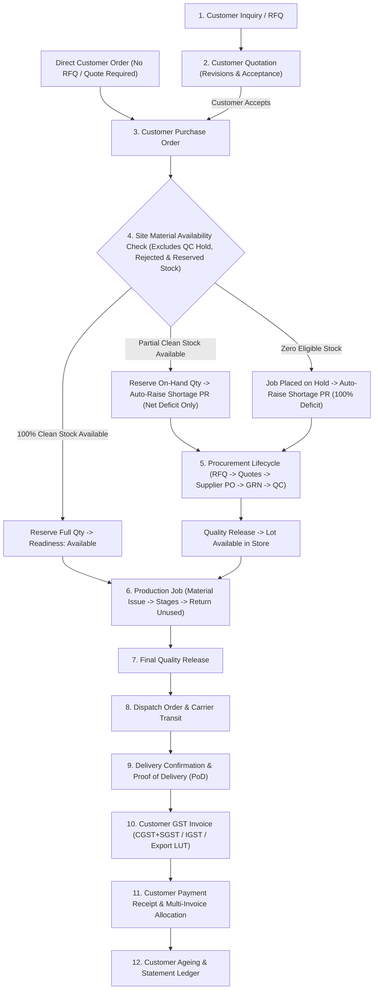
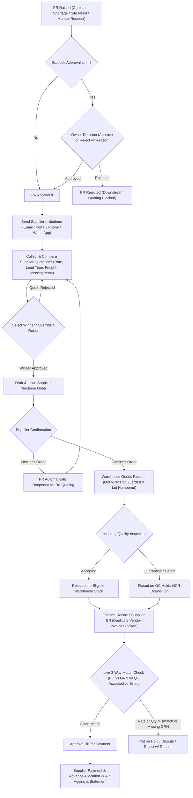
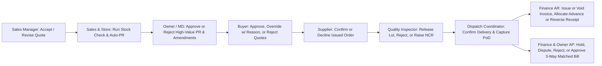

# EOSS — End-to-End Business Lifecycle Flow

EOSS connects every department of an MSME manufacturing and trading business—from customer inquiry and stock planning through procurement, shop-floor production, quality control, dispatch, customer collections, supplier billing, and complete audit accountability—using one connected system.

---

## 1. Master Order-to-Cash (O2C) & Material Shortage Flow

---

## 2. Procurement, Receiving, 3-Way Match & Payables Flow (P2P)

---

## 3. Departmental Approve, Reject, Hold & Reverse Decision Flow

---

## 4. Universal Audit Accountability Across Every Step

Every business action across EOSS—creating records, editing commercial terms, approving or rejecting requests, holding or disputing bills, voiding invoices, reversing bounced payments, releasing quality lots, confirming delivery PoD, and updating customer or supplier profiles—automatically records an entry in the **Audit Trail**:

- **In-Context Record History:** Built directly into every customer quote, customer order, requisition, supplier quote, supplier order, goods receipt, inspection, production job, dispatch, customer invoice, payment receipt, supplier bill, customer profile, supplier profile, asset, maintenance ticket, document, and company setting.
- **Enterprise Audit Timeline:** Filter across all departments by reference number, user, business role, action type, and date range, with **expandable side-by-side comparisons showing Previous Value vs New Value** and mandatory reasons wherever exceptions occur.
- **Prototype Simulation Clarity:** Simulated customer/supplier emails, printable GST tax invoices and purchase orders, bank payment postings, and supplier confirmations display a clear **Prototype Simulation** notice so workshop participants know no external bank or government portal is called.
